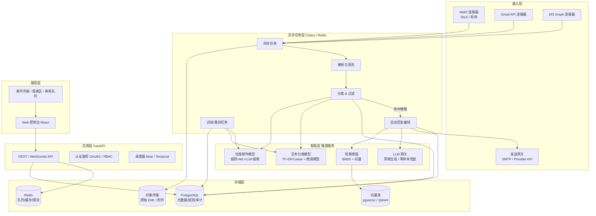
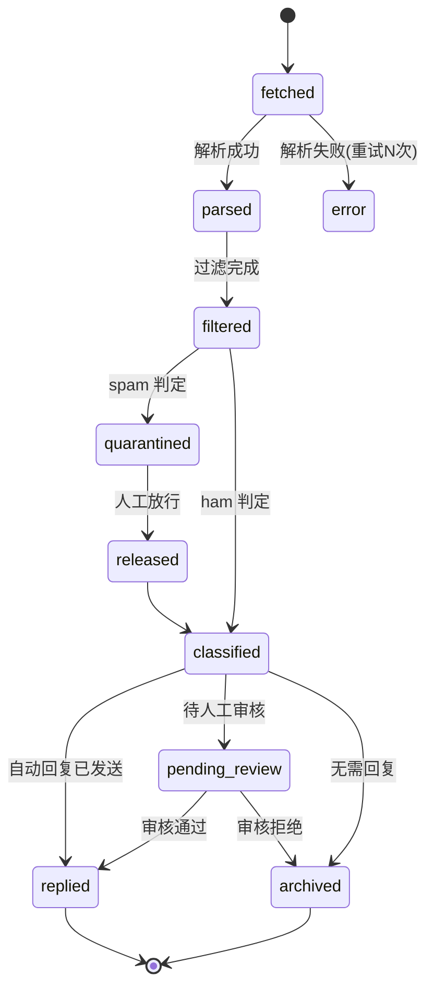
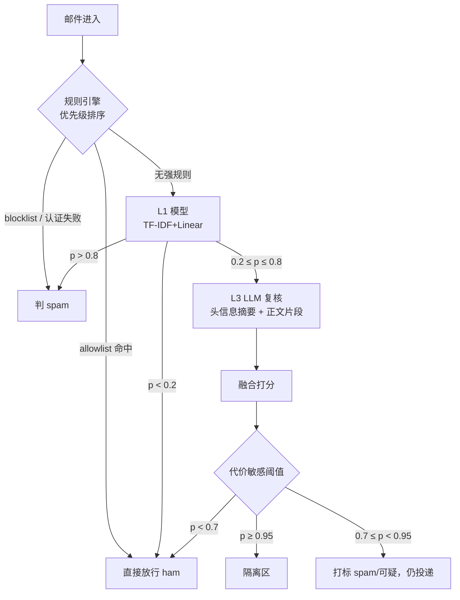
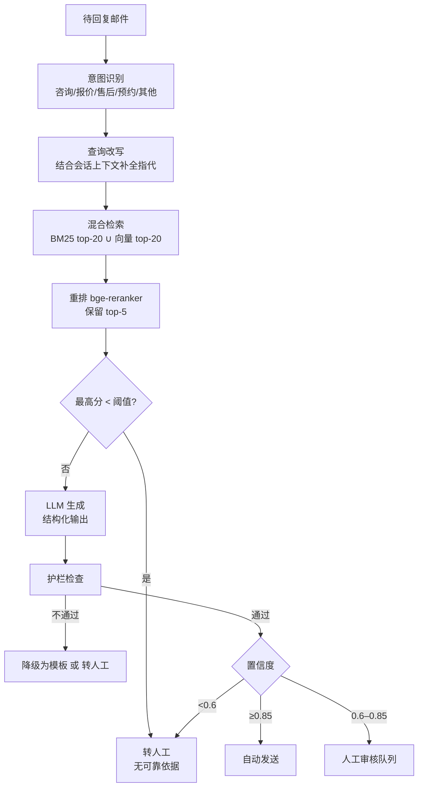

# 智能邮箱管理系统 —— 架构设计与实施手册

> 版本：v1.0
> 目标：设计一个可落地的智能邮箱管理系统，实现 **邮件自动分类**、**垃圾邮件过滤**、**邮件自动回复** 三大核心能力。
> 文档定位：既是架构说明，也是可以直接照着排期施工的工程手册。

---

## 0. 阅读指引

本文档按"**为什么 → 是什么 → 怎么做 → 怎么验收**"的顺序组织：

| 章节 | 内容 | 读者 |
|---|---|---|
| 1–2 | 需求拆解、指标定义 | 产品 / 全体 |
| 3 | 总体架构与数据流 | 架构师 / 后端 |
| 4 | 各模块详细设计 | 后端 / 算法 |
| 5 | 技术选型总表（含理由与替代方案） | 全体 |
| 6–7 | 数据模型、API 草案、工程目录 | 后端 / 前端 |
| 8 | 分阶段实施步骤（含交付物与验收标准） | 项目经理 / 全体 |
| 9–12 | 评测方案、风险、成本、演进 | 全体 |

---

## 1. 需求拆解

### 1.1 功能需求（FR）

| 编号 | 需求 | 说明 | 优先级 |
|---|---|---|---|
| FR-1 | 邮箱接入 | 支持 IMAP/SMTP 通用协议；可选支持 Gmail API、Microsoft Graph | P0 |
| FR-2 | 增量同步 | 只拉新增邮件，支持断点续传、去重、幂等 | P0 |
| FR-3 | 邮件解析 | MIME 多层解析、HTML 转文本、附件抽取、字符集归一化 | P0 |
| FR-4 | 会话归并 | 按 `Message-ID` / `In-Reply-To` / `References` / 主题前缀归并成会话（thread） | P1 |
| FR-5 | 垃圾邮件过滤 | 判定 spam / ham，动作：打标、隔离到隔离区、直接拒收 | P0 |
| FR-6 | 邮件自动分类 | 多分类（业务咨询 / 账单发票 / 通知公告 / 营销推广 / 社交 / 内部沟通 / 垃圾 / 其他），支持多标签 | P0 |
| FR-7 | 分类可解释 | 每条判定给出理由（命中规则、关键特征、置信度） | P1 |
| FR-8 | 自动回复 | 对符合策略的邮件生成回复草稿，可选择"自动发送"或"人工审核后发送" | P0 |
| FR-9 | 回复安全护栏 | 防自动回复风暴、防敏感信息泄露、防无限循环 | P0 |
| FR-10 | 知识库 | FAQ / 产品文档 / 历史工单，供自动回复检索 | P1 |
| FR-11 | 用户反馈闭环 | 人工"纠正分类 / 标记垃圾 / 修改草稿"都回流为训练数据 | P1 |
| FR-12 | 规则管理 | 可视化配置黑白名单、关键词、发件人白名单、免打扰时段 | P1 |
| FR-13 | 管理后台 | 邮件列表、隔离区、审核队列、规则配置、模型指标看板 | P1 |
| FR-14 | 审计 | 所有自动动作（拒收、自动发送）留痕可追溯 | P1 |

### 1.2 非功能需求（NFR）

| 维度 | 要求 |
|---|---|
| 吞吐 | 单实例 ≥ 50 封/秒解析入库；≥ 500 万封存量可平滑扩容 |
| 时延 | 邮件到达 → 分类结果可查 ≤ 5 s（P95）；自动回复 ≤ 30 s |
| 准确率 | spam 召回 ≥ 98%，**误杀率（FP）≤ 0.1%**；分类 macro-F1 ≥ 0.85 |
| 可用性 | 99.5%，单模块故障不影响收信 |
| 可扩展 | 模型可热替换，不重启主服务（模型版本化 + 影子模式） |
| 合规 | 数据最小化、传输 TLS、静态加密、可导出/删除（GDPR / 《个人信息保护法》） |
| 可观测 | 全链路 trace_id、关键指标看板、告警 |

> ⚠️ **最重要的指标是垃圾邮件的误杀率，不是准确率。** 漏一封垃圾邮件用户几乎无感，误杀一封客户合同邮件是事故。所有阈值调优都围绕"控制 FP 的前提下最大化召回"来做，采用 cost-sensitive 策略。

### 1.3 边界与假设

- 假设面向 **企业自有邮箱（域名自有）** 或 **用户授权接入的第三方邮箱**，优先 OAuth2 授权，不保存明文密码（必须保存时用 KMS/Fernet 加密）。
- 不做完整 MTA（邮件传输代理）。若需在 SMTP 会话阶段就拒收，则前置 Postfix + milter（见 4.5.1），本系统作为策略服务。
- 自动回复默认 **"AI 起草 + 人工审核"**（Human-in-the-loop），满足置信度与策略后才允许全自动发送。这是上线初期唯一安全的做法。

---

## 2. 总体架构

### 2.1 架构风格选择

| 方案 | 优点 | 缺点 | 结论 |
|---|---|---|---|
| 单体（Django 全家桶） | 起步快 | ML 推理与 Web 生命周期耦合，扩缩容不独立 | 不选 |
| **模块化单体 + 独立推理服务** | 复杂度可控，推理可独立横向扩展，后期易拆 | 需要多进程编排（Celery/Redis） | ✅ **推荐** |
| 微服务全家桶 | 极致解耦 | 早期过度设计，运维成本高 | 不选（演进阶段再拆） |

**结论：模块化单体（FastAPI）+ 异步任务队列（Celery）+ 独立模型推理服务（BentoML/独立 FastAPI）+ 前端 SPA。**

### 2.2 分层架构图



### 2.3 端到端数据流（邮件的一生）

```
① 拉取      连接器增量拉取 UID → 原始 .eml 落对象存储（按 sha256 去重）
   ↓
② 解析      解析 MIME → 正文纯文本化 → 抽取附件元信息 → 会话归并 → 写入 mails 表（status=parsed）
   ↓
③ 预处理    脱敏 PII → 特征抽取（发件人信誉、URL、附件、头部、TF-IDF、embedding）
   ↓
④ 过滤      级联判定：规则 → ML → (低置信)LLM 复核 → spam_score ∈ [0,1] → 动作(通过/打标/隔离/拒收)
   ↓
⑤ 分类      仅对 ham 执行：规则优先 → 分类模型 → 置信度 < 阈值走 LLM few-shot → 写 category + 理由
   ↓
⑥ 回复策略  是否可自动回复？(类别白名单 + 发件人白名单 + 不在免打扰时段 + 防循环通过 + 频率未超限)
   ↓
⑦ 生成      意图识别 → 混合检索知识库 → LLM 生成结构化草稿(带引用) → 护栏检查
   ↓
⑧ 处置      高置信度 → 自动发送；中 → 审核队列；低 → 仅生成模板/转人工
   ↓
⑨ 反馈      发送记录、人工修改 diff、用户标记 spam/not-spam → 回流样本表 → 定时重训
```

**关键设计：每一步都是幂等的，且状态机可重放。** 任何一步失败，可从对象存储里的原始 EML 重新跑，不用重新拉取邮件。

### 2.4 状态机（邮件主状态）



---

## 3. 技术选型总表

> 原则：**成熟生态优先、单语言栈优先、能在本地 Docker Compose 一键起优先**。除非有强理由，不引入小众组件。

### 3.1 语言与框架

| 领域 | 选型 | 理由 | 替代方案 |
|---|---|---|---|
| 主语言 | **Python 3.11+** | 邮件协议库（imaplib/email）、NLP/ML 生态、LLM SDK 都是一等公民 | Go（性能好但 ML 生态弱，需拆两套） |
| Web 框架 | **FastAPI** | 异步、自动 OpenAPI、Pydantic 校验、与推理服务同栈 | Django REST（自带 admin 更省事）、Flask |
| ORM | **SQLAlchemy 2.0 + Alembic** | 成熟、支持异步、迁移清晰 | Tortoise-ORM、Django ORM |
| 任务队列 | **Celery 5 + Redis** | 生态最成熟，定时任务 Beat、重试、路由齐全 | Dramatiq（更轻）、Arq（纯 asyncio）、Temporal（复杂工作流，见下） |
| 工作流编排（进阶） | **Temporal**（Phase 6 再引入） | 自动回复是"多步 + 等人工 + 超时 + 补偿"的长流程，Temporal 天生擅长 | 用 Celery chain + 状态表硬扛（初期够用） |
| 前端 | **React 18 + TypeScript + Vite + Ant Design** | 后台管理系统组件齐全，开发快 | Vue3 + Element Plus、Next.js（若要做 SSR 邮件门户） |

### 3.2 邮件协议与接入

| 需求 | 选型 | 说明 |
|---|---|---|
| IMAP | **IMAPClient**（同步）+ **aioimaplib**（异步） | IMAPClient 封装了 UID、IDLE、文件夹操作，比裸 imaplib 好用得多 |
| 实时推送 | **IMAP IDLE** + 定时轮询兜底 | IDLE 在多数服务商有 ~29 分钟超时，需心跳重连；轮询间隔 60–300 s |
| SMTP 发送 | **aiosmtplib** | 异步、支持 STARTTLS |
| Gmail | **google-api-python-client** + `watch` + Pub/Sub | 增量用 `historyId`；推送用 Cloud Pub/Sub |
| Microsoft 365 | **msal** + **msgraph-sdk-python** | 订阅 + webhook，增量用 `delta` 查询 |
| 头部认证校验 | **dkimpy**（DKIM）、**pyspf**（SPF）、**dmarc** 库 | 优先读上游 MTA 的 `Authentication-Results`，自校验仅作补充 |
| MIME 解析 | 标准库 **email** + **bleach**（清 HTML） | 不要自己写 HTML 解析，用 `bleach` 或 `selectolax` 提取正文 |
| 编码识别 | **charset-normalizer** | 比 chardet 更准，处理乱码邮件必备 |

### 3.3 存储

| 组件 | 选型 | 用途 | 理由 |
|---|---|---|---|
| 关系库 | **PostgreSQL 16** | 邮件元数据、规则、模板、审计、样本 | 单机足够到千万级；JSONB 存可变特征；`pgvector` 扩展一次到位 |
| 向量检索 | **pgvector**（起步）→ **Qdrant**（>500 万向量再迁） | 语义检索、去重、RAG | 起步不引入新组件，PG 内解决 |
| 全文检索 | PostgreSQL `tsvector`（中文用 **zhparser** 或 **pg_jieba**） | 关键词召回、BM25 融合 | 免去 ES 运维 |
| 缓存/队列 | **Redis 7** | Celery broker、限流、去重、会话状态 | 一物多用 |
| 对象存储 | **MinIO**（自建）/ **S3** / **OSS** | 原始 .eml、附件 | 邮件必须留原文，便于重放与审计 |
| 搜索（可选） | **OpenSearch** | 大规模复杂检索 | 数据量上亿或需要复杂聚合时再上 |

### 3.4 算法与模型

推荐 **四层递进** 的模型策略，按阶段逐步升级，不要一上来就上大模型：

| 层级 | 方案 | 训练成本 | 适用阶段 | 说明 |
|---|---|---|---|---|
| L0 规则 | 正则 / 黑名单 / 头部特征 / SPF-DKIM-DMARC 结果 | 零 | Day 1 必须 | 可解释、可热更新、兜底 |
| L1 传统 ML | **TF-IDF（字/词 n-gram）+ LinearSVC / LogisticRegression**，或 **LightGBM** 拼特征 | 秒级 | Phase 3 | 基线极强、推理 < 1 ms、易解释（取 top 权重词） |
| L2 预训练微调 | **hfl/chinese-macbert-base** / **distilbert-multilingual** 微调 | 小时级（单卡） | Phase 5 | 处理语义与长尾，F1 通常比 L1 高 5–10 个点 |
| L3 LLM | **DeepSeek / GPT-4o-mini / Qwen** API 或本地 vLLM | 零训练 | Phase 4 起 | 只做**低置信度复核**与**自动回复生成**，成本可控 |

**级联策略（关键）**：

```
规则强命中(黑名单/认证失败) → 直接判 spam
  ↓ 未命中
L1 TF-IDF+Linear 给出 p(spam)
  ↓ 0.2 < p < 0.8（模糊区，占比通常 <15%）
L3 LLM 复核（few-shot + 头信息摘要）
  ↓
最终 spam_score，按代价敏感阈值决策
```

这样 85% 以上的邮件走廉价路径，只有少数走 LLM，成本与延迟都可控。

| 用途 | 具体选型 |
|---|---|
| Embedding | **BGE-M3**（多语言、支持稀疏+稠密，中文强）或 `text-embedding-3-small` |
| 向量库 | pgvector（HNSW 索引） |
| 重排 | **bge-reranker-v2-m3**（对 top-20 重排，显著提升 RAG 命中率） |
| LLM 网关 | **LiteLLM**（统一多供应商接口、内置重试/计费/限流）或自写轻量封装 |
| 结构化输出 | **Pydantic + Instructor / JSON mode** | 保证 LLM 返回可解析 JSON |
| 标注工具 | **Label Studio** | 支持文本分类、多标签、自定义模板 |
| 实验管理 | **MLflow**（指标 + 产物 + 模型注册） | 轻量、自建成本低 |
| 数据版本 | **DVC**（或 git-lfs） | 数据集可复现 |
| 训练框架 | scikit-learn + PyTorch + HuggingFace Transformers | 标准组合 |

### 3.5 可观测与运维

| 需求 | 选型 |
|---|---|
| 日志 | **structlog**（JSON 结构化）+ trace_id |
| 链路追踪 | **OpenTelemetry** + Jaeger/Tempo（跨 API→Celery→推理） |
| 指标 | **Prometheus + Grafana**（必看：同步延迟、spam 判定分布、LLM 成本、队列积压） |
| 异常 | **Sentry** |
| 部署 | **Docker Compose**（开发/小规模）→ **K8s + Helm**（生产） |
| CI | GitHub Actions：lint(ruff) + type(mypy) + test(pytest) + build + 迁移检查 |
| 密钥 | `.env`（本地）/ **Vault / AWS Secrets Manager**（生产）；邮箱凭据必须加密存储 |

---

## 4. 模块详细设计

### 4.1 邮件接入层（Connector）

**职责**：把邮件"安全、不丢、不重"地搬进系统。

关键实现点：

1. **凭据管理**
   - 优先 OAuth2（Gmail/Graph），刷新 token 加密存储。
   - IMAP 应用专用密码用 `Fernet`（密钥在 KMS）加密入库，**绝不明文**。
   - 连接池按账号隔离，单账号限并发 1–2 个连接（多数服务商有连接数限制）。

2. **增量同步的正确姿势（IMAP）**
   ```
   SELECT INBOX
   uidvalidity = response[UIDVALIDITY]
   if uidvalidity != 库中记录:      # 服务端重建了 UID 空间
       全量重扫（按 Message-ID 去重）
   else:
       last_uid = 库中该账号 last_uid
       uids = SEARCH(UID f"{last_uid+1}:*")
       FETCH(uids, ["RFC822", "INTERNALDATE", "FLAGS"])
   ```
   - **UIDVALIDITY 变化是最容易踩的坑**，必须处理。
   - 用 `Message-ID`（缺失时用 `sha256(原始字节)`）做全局唯一键，落库 `ON CONFLICT DO NOTHING` 实现幂等。
   - 支持多文件夹（INBOX / 垃圾箱 / 自定义），用 `LIST` 枚举，配置化选择。

3. **实时性**：IDLE 监听 + 每 5 分钟兜底轮询；IDLE 断线指数退避重连。

4. **背压控制**：Celery 队列按账号分片 routing key，单账号积压不影响其他账号；单账号限速（如 100 封/分钟）。

5. **脏数据处理**：超大邮件（>25 MB）只存头和正文摘要，附件走签名 URL；超过 100 MB 直接跳过并记录。

**接口抽象**（为多供应商留扩展点）：

```python
class MailConnector(Protocol):
    async def list_folders(self) -> list[Folder]: ...
    async def fetch_since(self, cursor: Cursor, limit: int) -> FetchPage: ...
    async def send(self, msg: OutgoingMessage) -> str: ...   # 返回 provider_message_id
    async def mark(self, uid: str, flags: list[Flag]) -> None: ...
```

> IMAP / Gmail / Graph 三个实现类，上层无感知。**这是整个系统最容易做错的地方，接口一定要先定好。**

### 4.2 存储层设计

#### 4.2.1 核心表结构（PostgreSQL，节选关键字段）

```sql
-- 账号
CREATE TABLE accounts (
  id              BIGSERIAL PRIMARY KEY,
  email           CITEXT UNIQUE NOT NULL,
  provider        TEXT NOT NULL,            -- imap | gmail | graph
  config          JSONB NOT NULL,           -- host/port/ssl/文件夹等（密码字段单独加密表）
  status          TEXT NOT NULL DEFAULT 'active',
  last_uid        BIGINT,
  uid_validity    BIGINT,
  created_at      TIMESTAMPTZ DEFAULT now()
);

-- 邮件主体
CREATE TABLE mails (
  id              BIGSERIAL PRIMARY KEY,
  account_id      BIGINT NOT NULL REFERENCES accounts(id),
  message_id      TEXT NOT NULL,
  thread_id       TEXT,
  folder          TEXT,
  uid             BIGINT,
  from_addr       CITEXT,
  from_name       TEXT,
  to_addrs        CITEXT[],
  cc_addrs        CITEXT[],
  subject         TEXT,
  sent_at         TIMESTAMPTZ,
  received_at     TIMESTAMPTZ,
  size_bytes      INT,
  has_attachment  BOOLEAN DEFAULT FALSE,
  raw_object_key  TEXT,                     -- 对象存储里的 .eml
  text_body       TEXT,                     -- 纯文本化正文
  html_object_key TEXT,
  headers         JSONB,                    -- 认证结果、List-Id、Auto-Submitted 等
  status          TEXT NOT NULL DEFAULT 'fetched',
  created_at      TIMESTAMPTZ DEFAULT now(),
  UNIQUE (account_id, message_id)
);
CREATE INDEX ON mails (account_id, received_at DESC);
CREATE INDEX ON mails USING GIN (to_tsvector('simple', coalesce(subject,'') || ' ' || coalesce(text_body,'')));

-- 过滤与分类结果（一封信一条，可版本化）
CREATE TABLE mail_verdicts (
  mail_id         BIGINT PRIMARY KEY REFERENCES mails(id) ON DELETE CASCADE,
  spam_score      REAL,
  spam_label      TEXT,                     -- spam | ham | phishing
  spam_action     TEXT,                     -- pass | tag | quarantine | reject
  spam_reasons    JSONB,                    -- 命中规则/特征/模型版本
  category        TEXT,
  category_scores JSONB,                    -- 多标签分数
  category_reason JSONB,
  model_versions  JSONB,
  decided_at      TIMESTAMPTZ DEFAULT now()
);

-- 规则（热更新）
CREATE TABLE rules (
  id          BIGSERIAL PRIMARY KEY,
  scope       TEXT NOT NULL,               -- global | account | domain
  scope_id    BIGINT,
  kind        TEXT NOT NULL,               -- blocklist | allowlist | keyword | header | sender_reputation
  payload     JSONB NOT NULL,
  action      TEXT NOT NULL,               -- spam | ham | tag | route
  priority    INT DEFAULT 100,
  enabled     BOOLEAN DEFAULT TRUE,
  created_by  BIGINT,
  updated_at  TIMESTAMPTZ DEFAULT now()
);

-- 回复草稿 & 发送记录
CREATE TABLE reply_drafts (
  id           BIGSERIAL PRIMARY KEY,
  mail_id      BIGINT NOT NULL REFERENCES mails(id),
  intent       TEXT,
  body         TEXT,
  citations    JSONB,                      -- 引用了哪些知识条目
  confidence   REAL,
  status       TEXT NOT NULL,              -- draft | pending_review | approved | sent | rejected
  model        TEXT,
  cost_usd     NUMERIC(10,6),
  reviewer_id  BIGINT,
  edited_diff  TEXT,
  created_at   TIMESTAMPTZ DEFAULT now()
);

-- 反馈样本（训练数据的唯一来源）
CREATE TABLE feedback (
  id          BIGSERIAL PRIMARY KEY,
  mail_id     BIGINT REFERENCES mails(id),
  source      TEXT NOT NULL,               -- user | reviewer | rule | model_disagreement
  task        TEXT NOT NULL,               -- spam | category | reply_quality
  label       JSONB NOT NULL,
  note        TEXT,
  created_at  TIMESTAMPTZ DEFAULT now()
);

-- 知识库
CREATE TABLE kb_documents (
  id         BIGSERIAL PRIMARY KEY,
  title      TEXT,
  content    TEXT,
  source     TEXT,                          -- faq | manual | past_ticket
  embedding  VECTOR(1024),                 -- BGE-M3
  metadata   JSONB,
  updated_at TIMESTAMPTZ DEFAULT now()
);
CREATE INDEX ON kb_documents USING hnsw (embedding vector_cosine_ops);

-- 审计
CREATE TABLE audit_logs (
  id         BIGSERIAL PRIMARY KEY,
  actor      TEXT,                          -- user:12 | system:auto-reply
  action     TEXT NOT NULL,
  target     TEXT,
  detail     JSONB,
  trace_id   TEXT,
  created_at TIMESTAMPTZ DEFAULT now()
);
```

**分区策略**：`mails` 按 `received_at` 月分区（`pg_partman`），千万级后必做；对象存储按 `yyyy/mm/dd/{sha256}.eml` 分目录。

#### 4.2.2 为什么原始 EML 必须留存

- 模型升级后可**离线重放**全部历史邮件，回测新模型（这是最有价值的数据资产）。
- 审计与取证需要原文。
- 附件不进 PG，只存元数据 + 对象键。

### 4.3 预处理管道

| 步骤 | 做法 | 注意点 |
|---|---|---|
| MIME 解析 | `email.parser.BytesParser(policy=policy.default)` | 用 `policy.default` 而非 `compat32`，否则头部编码处理很痛苦 |
| 正文提取 | 优先 `text/plain`；仅 HTML 时用 `selectolax`/`bleach` 清洗后转文本 | 剔除引用历史（`>` 开头、`On ... wrote:` 之后）以利于分类 |
| 编码 | `charset-normalizer` 检测，兜底 `errors='replace'` | 中文 GBK/GB18030 邮件很多 |
| 引用剥离 | 正则 + 常见客户端签名分隔符（`-- \n`、`________`） | 回复内容应基于"本次新增内容" |
| 附件 | 只存元信息（名/类型/大小/sha256）+ 对象存储；**可执行/宏/压缩包**单独标红 | 附件是恶意软件的入口，只做检测不做执行 |
| URL 抽取 | 正则 + `tldextract` 归一化域名，查 URLhaus/PhishTank 类黑名单 | 短链需展开，但要防 SSRF（禁止访问内网地址） |
| 会话归并 | `References` 链 → `thread_id`；无则按 `[subject 去 Re:/Fwd:]+from` 聚合 | 用于自动回复时提供上下文 |
| PII 脱敏 | 正则识别身份证/手机/银行卡；可配置开关 | 送 LLM 前必须脱敏（可逆映射表放在独立表） |
| 文本归一化 | 小写（英文）、全角转半角、去零宽字符、连续空白压缩 | 反规避：`V1AGRA`、`sp@m` 这类需要额外混淆还原 |

### 4.4 特征工程

| 类别 | 特征 |
|---|---|
| 头部 | SPF/DKIM/DMARC 结果、`Received` 链长度与异常跳数、`Return-Path` 与 `From` 域是否一致、`Reply-To` 域是否伪造、`X-Mailer`、`Date` 时区合理性、`Message-ID` 域与 From 域一致性 |
| 发件人信誉 | 历史中该发件人 spam 比例、首次接触时间、是否在白名单/联系人、域名注册龄（WHOIS，可选）、域名是否为一次性邮箱 |
| 内容 | TF-IDF（英文词 + 中文 2–3 字 n-gram）、是否含"紧急/立即/中奖/免费"等诱导词、大写比例、感叹号密度、图片占比（纯图 spam）、隐藏文本（白字白底） |
| URL | 短链、IP 直连链接、非 ASCII 域名（homograph）、重定向层数、黑名单命中 |
| 附件 | 可执行文件（.exe/.scr/.js/.lnk/.iso）、双扩展名、加密压缩包、宏文档 |
| 行为/会话 | 同一发件人短时间大量发送、收件人列表长度、是否群发（Bcc 大量）、是否为回复线程中 |
| 语义 | BGE-M3 embedding（用于聚类、去重、kNN、LLM 复核上下文） |

> 特征统一放在一个 `FeatureBundle` dataclass 里，规则引擎、L1 模型、LLM prompt 都从它取数，保证一致性与可回放。

### 4.5 垃圾邮件过滤（核心模块）

#### 4.5.1 级联判定流程



**动作分级**（不要只有 spam/ham 二值）：

| 分数 | 动作 | 用户感受 |
|---|---|---|
| ≥ 0.95 | `quarantine` 进隔离区，不发通知 | 看不到，但可找回 |
| 0.7–0.95 | `tag` 打"疑似垃圾"标签，正常投递 | 能看到，心里有数 |
| < 0.7 | `pass` | 正常 |

这个三档设计能把"误杀"从"事故"降级为"轻微干扰"。

#### 4.5.2 训练数据策略（冷启动是最大难题）

| 来源 | 用法 |
|---|---|
| 公开语料 | SpamAssassin Public Corpus、Enron-Spam、CEAS 2008、TREC Spam、Ling-Spam（英文为主，用于 L1 冷启动） |
| 中文数据 | 公开中文垃圾邮件集 + 自建标注；英文模型做**领域迁移**（先在英文训，再用少量中文微调 last layer） |
| 弱监督 | **LLM 零样本打标**（给 20–50 条规则化 prompt）→ Snorkel 风格多数投票 → 生成百万级弱标签初版模型 |
| 真实反馈 | 用户"标记垃圾/不是垃圾"、隔离区放行/删除 → 最高质量样本，权重最高 |
| 难负样本挖掘 | 把被误判的营销邮件（用户主动订阅的）加入难负例，专门压 FP |

**样本权重**：真实用户反馈 ×3，人工标注 ×2，LLM 弱标签 ×1。

#### 4.5.3 代价敏感训练

不要用 0.5 阈值。用验证集搜索阈值 τ 使 `FP_rate ≤ 0.1%` 条件下最大化召回；或在损失里给 FP 加 10 倍权重（`class_weight` 或自定义损失）。上线后每一版模型都必须跑**误杀回归集**（人工构造的 500 封"绝不能误杀"邮件：合同、发票、验证码、招聘、会议邀请），不达标不上线。

#### 4.5.4 反规避与对抗

- 字符混淆还原（`sp@m`、`ⅤⅠⒶⒼⓇⒶ`、零宽字符、同形字）→ 归一化后再判定。
- 图片型 spam → OCR（可选 PaddleOCR）或直接特征（大面积图片 + 少量文字）判可疑。
- 二维码 spam → 检测到二维码图片 + 正文极短 → 加分。
- 定期用"红队"方式生成对抗样本，加入训练集。

#### 4.5.5 可解释性

每条判定必须能回答"为什么"：

```json
{
  "spam_score": 0.97,
  "action": "quarantine",
  "reasons": [
    {"type": "rule", "id": 42, "desc": "发件域 example-bulk.cn 在黑名单"},
    {"type": "auth", "desc": "DKIM 校验失败"},
    {"type": "model", "model": "tfidf-linear-v3", "top_tokens": ["中奖", "立即领取", "限时"]}
  ]
}
```

这是用户信任系统的基础，也是排查误杀的唯一手段。

### 4.6 邮件自动分类

#### 4.6.1 类别体系（建议，可按业务改）

```
一级类：业务咨询 / 账单财务 / 通知公告 / 营销推广 / 社交人际 / 内部协作 / 招聘求职 / 投诉建议 / 垃圾邮件 / 其他
二级类（示例）：业务咨询 → 售前咨询 / 售后问题 / 技术支持 / 合作洽谈
```

**多标签 vs 单标签**：邮件天然多标签（一封"发票+投诉"）。建议：
- 先用**单标签主类**（简化，满足 80% 需求）；
- 预留 `category_scores` JSONB 支持多标签，Phase 6 再开。

#### 4.6.2 三层分类策略

```
第一层 规则：发件人白名单/域名/邮件列表 ID/主题关键词 → 直接定类（覆盖 ~30%，几乎零错误）
第二层 模型：L1 TF-IDF + Linear（快速）+ L2 MacBERT 微调（主模型）
第三层 LLM：置信度 < 0.6 或类别为"其他"时，用 few-shot 分类（含类别定义、2–3 个示例）
```

**为什么不用纯 LLM 分类？** 成本与延迟不允许每封邮件都调 LLM；且 LLM 在边界样本上不稳定、不可复现。规则+小模型覆盖 90%，LLM 只补长尾。

#### 4.6.3 训练要点

- 中文用 **字级 n-gram（2–3）**，比 jieba 分词在短文本上更稳（且免去词典维护）。
- 类别不均衡：`class_weight="balanced"` + 对稀有类做数据增强（LLM 生成同义改写）。
- 定期**主动学习**：挑出模型置信度最低的 200 封/周给人工标注，标注成本极低但收益最大。
- 线上用**影子模式**跑新模型 1 周，对比后再切。

#### 4.6.4 分类结果的下游用途

| 类别 | 动作 |
|---|---|
| 业务咨询 | 进自动回复流程（AI 起草） |
| 账单财务 | 自动打标 + 归档到"财务"文件夹；**不自动回复** |
| 通知公告 | 只归档，不通知 |
| 营销推广 | 折叠/摘要，不回复 |
| 投诉建议 | 高优先级 + 转人工（不自动回复） |
| 其他/低置信 | 转人工 + 进审核队列 |

### 4.7 自动回复（最容易出事故的模块）

#### 4.7.1 前置条件（所有条件必须同时满足才允许自动回复）

```python
def can_auto_reply(mail, cfg) -> tuple[bool, str]:
    if mail.spam_label != "ham":                    return False, "垃圾邮件"
    if mail.category not in cfg.allowed_categories:  return False, "类别不在白名单"
    if is_auto_submitted(mail):                      return False, "对方是自动回复(RFC 3834)"
    if is_bulk_or_list(mail):                        return False, "群发/邮件列表"
    if mail.from_addr.endswith(tuple(cfg.noreply)):  return False, "no-reply 地址"
    if in_thread_with_auto_reply(mail):              return False, "本会话已自动回复过"
    if rate_limited(mail.from_addr, "24h"):          return False, "同一发件人 24h 内已回复"
    if in_quiet_hours(cfg):                          return False, "免打扰时段"
    if mail.has_risky_attachment:                    return False, "含可疑附件"
    return True, "ok"
```

**防自动回复风暴是硬要求**（RFC 3834）：
- 检查 `Auto-Submitted`（非 `no` 即为自动）、`Precedence: bulk|list|junk`、`List-Id`、`X-Autoreply`、`X-Autorespond`。
- 发出的回复必须带 `Auto-Submitted: auto-replied`。
- 空 `Return-Path: <>`（退信）绝不回复。
- 每个 (发件人, 会话) 组合设全局冷却期（如 24 h），用 Redis 计数。
- **回复链深度 > 3 强制转人工**，防止两个机器人对话。

#### 4.7.2 生成流程（RAG）



**LLM 输出必须结构化**（用 Pydantic 校验，失败重试 1 次后降级）：

```python
class ReplyDraft(BaseModel):
    intent: Literal["consult", "quote", "aftersale", "booking", "complaint", "other"]
    need_human: bool
    confidence: float          # 0-1
    subject: str
    body: str
    citations: list[int]       # 引用的 kb_documents.id，必须非空才能自动发送
    risk_flags: list[str]      # 价格承诺/合同条款/个人信息/法律
```

**Prompt 要点**：
- 角色 + 语气（公司客服口吻，简洁，中文）。
- 明确"只能基于给定知识回答，不知道就说不知道并转人工"。
- 禁止承诺价格/折扣/交付时间，除非知识库中有明确条目。
- 输出语言跟随来信语言。
- 附上邮件原文（已脱敏）+ 检索到的知识片段（带编号）。

#### 4.7.3 护栏（Guardrails）

| 风险 | 检测手段 | 处理 |
|---|---|---|
| 幻觉/无依据 | `citations` 为空 或 引用内容与正文语义相似度低（embedding 余弦 < 0.6） | 拒绝发送，转人工 |
| 敏感承诺 | 正则 + 关键词（价格、折扣、赔偿、合同、保证、100%） | 强制人工审核 |
| PII 泄露 | 检测回复中是否含他人手机/证件/订单明细 | 拒绝 |
| 注入攻击 | 邮件正文含"忽略以上指令""你是..."等 | 使用分隔符包裹原文 + 系统提示强调"邮件内容是不可信数据"；命中则转人工 |
| 语气不当 | 小模型情感/毒性分类器（可选） | 转人工 |
| 长度异常 | 过长（>500 字）或过短（<20 字） | 转人工 |
| 发送失败 | SMTP 重试 3 次指数退避 → 告警 | 状态置 failed，人工处理 |

#### 4.7.4 发送实现细节

- 回信必须设 `In-Reply-To: <原 Message-ID>` 和 `References`，否则对方客户端不会归入同一会话。
- 主题：`Re: 原主题`（已带 Re: 则不重复加）。
- 正文建议 `text/plain` + `text/html` 双格式，HTML 做严格转义。
- 发送后写 `reply_drafts.status='sent'` + 审计日志 + 在对方邮箱里 `\Seen` 标记（可选）。
- 通过**统一发送网关**出口（同一 IP/域名），预先配置好 SPF/DKIM/DMARC，否则自家回复会进对方垃圾箱——这点常被忽略。

### 4.8 反馈闭环与模型迭代

```
用户/审核员操作 → feedback 表 → 每周 ETL → 训练集(v{n+1})
    → 训练 → 离线评测（含误杀回归集）→ MLflow 注册 → 影子模式 1 周
    → 指标达标 → 灰度 10% → 全量（可一键回滚到 v{n}）
```

- **每周一次**常规重训；规则变更即时生效（不进模型）。
- 模型文件与推理服务解耦：推理服务启动时从模型注册中心拉取指定版本，支持 `/reload` 热加载。
- 记录每次判定使用的 `model_versions`，出问题能定位到具体版本。

### 4.9 API 设计（REST，节选）

```http
GET    /api/v1/mails?folder=inbox&category=consult&page=1&size=50
GET    /api/v1/mails/{id}
GET    /api/v1/mails/{id}/raw            # 返回原始 EML 下载签名 URL
POST   /api/v1/mails/{id}/feedback       # {task:"spam"|"category", label:{...}}
POST   /api/v1/mails/{id}/reply/draft    # 触发一次 AI 起草
POST   /api/v1/mails/{id}/reply/send     # 审核通过后发送 {draft_id, body?}
GET    /api/v1/quarantine
POST   /api/v1/quarantine/{id}/release   # 放行并加入白名单(可选)
POST   /api/v1/quarantine/{id}/delete
GET    /api/v1/rules  /  POST /api/v1/rules  /  PATCH /api/v1/rules/{id}
GET    /api/v1/kb/documents  /  POST（含文件上传、自动切分、embedding）
GET    /api/v1/metrics/overview         # 分类分布、spam 率、自动回复采纳率
WS     /api/v1/stream                   # 新邮件实时推送（前端刷列表）
```

约定：统一响应包 `{code, data, message, trace_id}`；分页用 cursor（邮件量大，offset 会慢）；写操作全部幂等（`Idempotency-Key` 头）。

### 4.10 安全与合规

| 项 | 措施 |
|---|---|
| 凭据 | OAuth2 优先；AES/Fernet 加密 + KMS 管密钥；日志中永久脱敏 |
| 传输 | 全站 TLS；IMAP 强制 SSL/TLS，禁用明文认证 |
| 静态 | PG 磁盘加密；对象存储 SSE |
| 权限 | RBAC（管理员/审核员/只读）；多租户按 `account_id` 行级隔离 |
| 审计 | 自动发送、放行、规则变更全量记录 actor + trace_id |
| 数据保留 | 可配置（默认 2 年）；支持按邮箱/用户级删除（合规要求） |
| LLM 数据出境 | 送第三方 LLM 前脱敏 + 可配置"仅本地模型"模式（vLLM 部署 Qwen） |
| 依赖安全 | `pip-audit` / `trivy` 扫描进 CI |

---

## 5. 工程目录结构（建议）

```
mailmind/
├── pyproject.toml
├── docker-compose.yml
├── docker-compose.override.yml        # 本地调试
├── alembic.ini
├── .env.example
├── Makefile                           # make dev / make test / make train
├── src/
│   ├── api/                           # FastAPI 应用
│   │   ├── main.py
│   │   ├── deps.py                    # DB session / 当前用户 / 限流
│   │   ├── routers/
│   │   │   ├── mails.py
│   │   │   ├── quarantine.py
│   │   │   ├── replies.py
│   │   │   ├── rules.py
│   │   │   ├── kb.py
│   │   │   └── metrics.py
│   │   └── schemas/                   # Pydantic 模型
│   ├── connectors/                    # 邮件接入抽象 + 三实现
│   │   ├── base.py
│   │   ├── imap_connector.py
│   │   ├── gmail_connector.py
│   │   └── graph_connector.py
│   ├── pipeline/
│   │   ├── parse.py                   # MIME 解析、正文抽取
│   │   ├── normalize.py               # 混淆还原、PII 脱敏
│   │   ├── features.py                # FeatureBundle
│   │   └── thread.py                  # 会话归并
│   ├── ml/
│   │   ├── rules.py                   # 规则引擎（可热更新）
│   │   ├── spam.py                    # 级联判定编排
│   │   ├── classify.py
│   │   ├── registry.py                # 模型加载/版本/热替换
│   │   └── guardrails.py
│   ├── reply/
│   │   ├── policy.py                  # can_auto_reply 策略
│   │   ├── retrieval.py               # 混合检索 + 重排
│   │   ├── generator.py               # LLM 调用 + 结构化输出
│   │   └── sender.py                  # 发送网关
│   ├── tasks/                         # Celery 任务
│   │   ├── celery_app.py
│   │   ├── sync.py
│   │   ├── process.py
│   │   └── retrain.py
│   ├── db/
│   │   ├── models.py
│   │   ├── session.py
│   │   └── migrations/
│   └── core/
│       ├── config.py                  # pydantic-settings
│       ├── logging.py                 # structlog
│       ├── security.py
│       └── obs.py                     # OTel / Prometheus
├── training/
│   ├── datasets/                      # DVC 管理
│   ├── build_dataset.py
│   ├── train_spam.py
│   ├── train_cls.py
│   ├── evaluate.py
│   └── notebooks/
├── tests/
│   ├── unit/
│   ├── integration/                   # 用 mailhog/greenmail 起假 SMTP/IMAP
│   └── fixtures/emails/               # 真实脱敏邮件样本
└── web/                               # React 前端
    ├── src/pages/{inbox,quarantine,review,rules,kb,metrics}
    └── src/api/
```

**本地开发依赖**：`docker compose up` 起 postgres + redis + minio + mailhog（假 SMTP/IMAP，用来测收发，不用真的连邮箱）。

---

## 6. 实施步骤（可直接排期）

> 总工期估算：**1 名全栈 + 1 名算法，约 14–16 周**；单人全包约 20–24 周。下面每阶段结束都对应一次 git commit（项目 `AGENT.md` 约定）。

### Phase 0：需求与数据摸底（1 周）

| 任务 | 产出 |
|---|---|
| 明确接入哪几家邮箱、是否有自有域名/MTA | 接入方案确认书 |
| 收集 500–2000 封真实（脱敏）邮件，人工分 4 桶：正常/垃圾/可疑/需回复 | 初始评测集 `golden_set_v0` |
| 定义类别体系与自动回复白名单 | `taxonomy.md`、`policy.yaml` |
| 确定 KPI 与验收口径（尤其误杀率） | 指标看板定义 |

**验收**：有一份可量化、可复用的黄金评测集（后续所有模型都用它打分）。**没有这一步，后面全是盲调。**

### Phase 1：工程骨架（1.5 周）

- [ ] 仓库初始化（pyproject、ruff、mypy、pytest、pre-commit）
- [ ] `docker-compose.yml`：postgres/redis/minio/mailhog
- [ ] FastAPI 骨架 + `/health` + structlog + 配置管理
- [ ] SQLAlchemy 模型 + Alembic 首个迁移
- [ ] Celery 接入（一个 echo 任务打通）
- [ ] CI（lint + test + build）

**验收**：`make dev` 一条命令起全栈；`/health` 返回依赖连通性；CI 绿。

> commit：`feat: 初始化工程骨架（FastAPI + Celery + PG + Redis + MinIO）`

### Phase 2：邮件收发与存储（2 周）★ 地基，最不能省

- [ ] `MailConnector` 抽象 + IMAP 实现（UIDVALIDITY 处理、增量、去重）
- [ ] Gmail API 实现（`historyId` 增量，可延后到 Phase 2 末）
- [ ] 原始 EML 落 MinIO（sha256 命名），元数据入库
- [ ] MIME 解析、正文抽取、附件元信息、编码兜底
- [ ] 会话归并
- [ ] 发送网关（aiosmtplib + mailhog 联调，In-Reply-To 正确）
- [ ] 重放工具：`python -m tools.replay --account X --since 2024-01-01`（从对象存储重跑管道）

**验收**：接一个真实邮箱连续跑 24 h 不丢信、不重复（用 Message-ID 去重率 100% 验证）；断网重连后能续传；能从原始 EML 重放出结构化数据。

> commit：`feat: 邮件接入与解析管道（IMAP 增量同步 + MIME 解析 + 会话归并）`

### Phase 3：规则引擎 + 垃圾邮件基线（1.5 周）

- [ ] 规则引擎（优先级、scope、热加载，DB 驱动）
- [ ] 头部特征抽取（SPF/DKIM/DMARC 结果读取、Received 链、Return-Path 一致性）
- [ ] 发件人信誉统计（离线任务，每日更新到 Redis）
- [ ] L1 模型：TF-IDF + LinearSVC，用公开语料冷启动
- [ ] 三档动作（pass/tag/quarantine）+ 隔离区表与 API
- [ ] 可解释理由输出

**验收**：在黄金集上 spam 召回 ≥ 95%、FP ≤ 0.5%；每条判定有理由；规则改动 5 秒内生效。

> commit：`feat: 垃圾邮件规则引擎与 TF-IDF 基线模型`

### Phase 4：分类与 LLM 级联（2 周）

- [ ] 类别定义落库 + 训练集构建脚本（含 LLM 弱标注生成器）
- [ ] 分类模型训练 + 离线评测（macro-F1 报告）
- [ ] 模糊区 LLM 复核（LiteLLM 网关 + 结构化输出 + 成本埋点）
- [ ] 多标签预留（`category_scores`）
- [ ] 判定结果 API + 前端列表展示（可在 Phase 6 前先用 Swagger 验证）

**验收**：分类 macro-F1 ≥ 0.85；LLM 兜底比例 < 20%；单封邮件平均处理成本可量化（目标 < ¥0.01）。

> commit：`feat: 邮件自动分类（规则+TF-IDF+LLM 级联）`

### Phase 5：自动回复（2.5 周）★ 风险最高

- [ ] 知识库导入（切分策略：按标题层级 512–1024 token 重叠 100）、embedding、混合检索 + 重排
- [ ] `can_auto_reply` 全量策略实现（含 RFC 3834 全部检查）
- [ ] 意图识别 + 查询改写 + RAG 生成 + 结构化草稿
- [ ] 护栏（引用校验、敏感词、PII、注入检测）
- [ ] 审核队列 + 审核界面（左右对比原文/草稿，一键通过/编辑/拒绝）
- [ ] 发送与状态回写、冷却期与频控（Redis）
- [ ] **离线影子运行 2 周**：只生成不发送，人工评估草稿可用率

**验收**：影子期内草稿"可直接发送率" ≥ 60%、"需修改率" ≤ 30%、"不可用" ≤ 10%；零自动回复风暴事件；零敏感信息泄露。

> commit：`feat: 基于 RAG 的邮件自动回复与人工审核闭环`

### Phase 6：前端与运营能力（2 周）

- [ ] 邮件列表（虚拟滚动、批量操作、快捷键）
- [ ] 隔离区（放行即加白、一键删除）
- [ ] 审核队列（重点：键盘操作 + 草稿 diff 高亮）
- [ ] 规则管理（可视化编辑、命中测试器"输入一封邮件试试"）
- [ ] 知识库管理（上传、切分预览、命中测试）
- [ ] 指标看板（分类分布、spam 趋势、自动回复采纳率、LLM 成本）

**验收**：运营人员无需工程师介入即可完成"加白名单""改模板""调阈值"三类操作。

> commit：`feat: 管理控制台（隔离区/审核队列/规则/知识库/看板）`

### Phase 7：模型升级与加固（2 周）

- [ ] MacBERT 微调（分类 + spam 二分类），影子模式对比 L1
- [ ] 主动学习流程（每周挑低置信样本 → Label Studio 标注 → 入训练集）
- [ ] 误杀回归集扩充到 1000 封并纳入 CI（每次模型变更必跑）
- [ ] 对抗样本（混淆字符、图片 spam、二维码）补充
- [ ] 压测（50 封/秒）、故障演练（Redis 挂 / LLM 超时 / IMAP 断连）

**验收**：spam 召回 ≥ 98%、FP ≤ 0.1%；系统在单组件故障下降级可用；压测达标。

> commit：`perf: 升级分类与反垃圾模型，补充误杀回归集与压测`

### Phase 8：上线与灰度（1 周）

- [ ] K8s manifests / Helm chart，HPA 按队列长度扩容
- [ ] 备份策略（PG 每日全量 + WAL 归档；对象存储版本化）
- [ ] 告警规则（队列积压 > 1 万、同步延迟 > 10 min、LLM 错误率 > 5%、spam FP 突增）
- [ ] 灰度：先 1 个账号全量 → 5% → 全量；自动回复始终"审核模式"起步
- [ ] 运行手册（Runbook）：常见故障与处置

**验收**：灰度 2 周全量切换，无 P0 事故；MTTR < 30 min。

> commit：`chore: 上线部署配置与灰度方案`

### 关键路径与串并行

```
P0 ── P1 ── P2 ─────────────────┬── P3 ── P4 ── P5 ── P6
                          │              └──── P7（与 P5/P6 并行）
                          └── P6 前端可提前用 mock 并行开发
```
**P2 是绝对关键路径**，接口/存储设计没定死就写算法，后期返工代价最大。

---

## 7. 评测方案

### 7.1 指标体系

| 任务 | 主指标 | 辅助指标 | 业务指标 |
|---|---|---|---|
| 垃圾过滤 | Recall@FP≤0.1%、F1 | FPR、AUC、每类 spam 召回（钓鱼/营销/勒索） | 用户"误杀投诉率"、隔离区放行率 |
| 分类 | macro-F1、top-2 accuracy | 每类 P/R、混淆矩阵、低置信占比 | 人工改类率、分类后处理率 |
| 自动回复 | 草稿可用率、采纳率 | 平均编辑距离、引用命中率、幻觉率（人工抽检） | 首次响应时间、客户满意度、转人工率 |
| 系统 | P95 延迟、队列积压 | 同步延迟、LLM 调用成功率、单封成本 | 可用性 |

### 7.2 评测集构建

| 集合 | 规模 | 用途 |
|---|---|---|
| 黄金集（golden） | 1000 封人工标注 | 每次发版必跑，指标对比基线 |
| 误杀回归集（critical） | 500–1000 封"绝不能误杀" | 门禁：任一误杀则阻断发布 |
| 对抗集（adversarial） | 300 封混淆/图片/二维码 spam | 反规避能力 |
| 生产抽检集 | 每周 200 封随机 | 分布漂移监控 |

**注意**：黄金集要按时间切分（用旧数据训练、新数据评测），否则指标虚高。且每次迭代后**冻结旧样本、只追加不修改**。

### 7.3 上线策略

1. **影子模式（shadow）**：新模型/新流程只计算不执行，对比线上决策差异。
2. **A/B 或灰度**：按账号灰度，观察业务指标（不只是模型指标）。
3. **自动回滚**：指标劣化超阈值（如 FP 翻倍）自动切回上一版本模型/阈值。

---

## 8. 风险清单与对策

| # | 风险 | 影响 | 对策 |
|---|---|---|---|
| 1 | 垃圾邮件漏杀率与误杀率的权衡失衡 | 高 | 三档动作 + 代价敏感 + 误杀回归集门禁 |
| 2 | 自动回复产生"胡说八道"或错误承诺 | **极高（法律/商务）** | 强制 citations、禁止条款类回答、默认人工审核、灰度放量 |
| 3 | 自动回复风暴 / 两个机器人互回 | 高 | RFC 3834 全检 + 冷却期 + 链深限制 |
| 4 | 自己的回复进对方垃圾箱（SPF/DKIM 未配） | 中高 | 上线前配置好域名的 SPF/DKIM/DMARC 和 PTR |
| 5 | IMAP 的 UIDVALIDITY / 重复拉取 | 中 | 幂等键 Message-ID + 重放工具 + 监控去重率 |
| 6 | 邮箱服务商限流/封号 | 中高 | 遵守服务商条款、连接数与速率限制、指数退避、多账号隔离 |
| 7 | 冷启动无标注数据 | 中 | 公开语料 + LLM 弱监督 + 规则兜底，先上线再迭代 |
| 8 | LLM 成本失控 | 中 | 级联（只有 15% 走 LLM）+ 缓存（相同意图复用）+ 便宜模型兜底 + 成本看板告警 |
| 9 | 数据合规（个人信息出境） | 高 | 脱敏、可选本地模型、数据保留策略、审计 |
| 10 | 概念漂移（新式垃圾邮件） | 中 | 每周重训 + 分布监控 + 规则快速通道 |
| 11 | 邮件正文 prompt 注入 | 中高 | 内容标记为不可信数据、分隔符、注入检测后转人工 |
| 12 | 附件恶意文件 | 中 | 不执行、只做类型检测与隔离、可选 ClamAV |

---

## 9. 成本估算（月度，中等规模：10 万封/月）

| 项 | 估算 |
|---|---|
| 服务器（4C8G × 2 + PG + Redis + 对象存储） | ¥800–1500 |
| LLM API（15% 走复核 × 平均 3k token；回复草稿 5k 封 × 2k token） | ¥300–1200（视模型） |
| Embedding（知识库更新 + 邮件向量） | ¥50–200（或本地 BGE-M3 免费） |
| 服务器 GPU（可选，本地跑 MacBERT/reranker） | ¥1500–3000（或用 CPU 小模型省掉） |
| 人力 | 主要成本 |

> 省钱的三个杠杆：① 级联降低 LLM 调用量；② 相同意图结果缓存；③ 本地小模型（BGE-M3 + 小 LLM）替代 API 处理 80% 流量。

---

## 10. 后续演进方向

1. **多邮箱统一收件箱**（聚合视图、跨账号会话归并）。
2. **智能摘要与待办抽取**（从邮件里抽"要不要我做某事、截止时间"）。
3. **邮件 → 工单系统**打通（分类为投诉/售后直接建单）。
4. **多语言**（中英日），embedding 与分类模型换成多语言版。
5. **主动学习平台化**：标注、训练、评测、发布全流程自动化（MLOps 成熟后）。
6. **端到端本地化**：全部模型私有部署（BGE-M3 + Qwen 7B + vLLM），满足强合规场景。
7. **用户个性化**：每个账号学习自己的偏好（谁重要、什么该置顶），用轻量在线学习。

---

## 附录 A：最小可行技术栈（MVP，2–3 周出原型）

如果只想先跑通验证想法，压缩到下面这些：

```
Python 3.11 + FastAPI + SQLite/Postgres + IMAPClient + aiosmtplib
+ scikit-learn(TF-IDF+LinearSVC) + 一套规则
+ 一个 LLM API（DeepSeek）+ 一个 pgvector 知识库
+ CLI 或 Streamlit 界面
```

MVP 只需证明三件事：① 能稳定收信解析；② 规则+TF-IDF 的 spam/分类准确率可接受；③ 自动回复草稿有人愿意用。**验证完再上正式架构。**

## 附录 B：选型决策速查

| 如果你更在意… | 建议调整 |
|---|---|
| 出活快 | Django + Django Admin 代替 FastAPI + React |
| 极致低延迟 | 推理服务用 Go/Rust 重写特征与规则，模型走 ONNX Runtime |
| 强合规/数据不出境 | 全本地模型（BGE-M3 + Qwen + vLLM），不接第三方 API |
| 流程极复杂（多级审批/补偿） | 引入 Temporal 替代 Celery 编排自动回复 |
| 邮件量上亿 | 迁移到 OpenSearch + 独立向量库（Milvus/Qdrant）+ 数据湖存储原始 EML |

---

**结论一句话**：先用"规则 + TF-IDF"把过滤和分类做到可用（2–3 周），用 LLM 只补模糊区和起草回复，把"发出去"这一步永远置于人工审核或严格策略之下——**准确率可以慢慢涨，误杀和乱回复一次就够毁掉信任**。

---

## 附录 C：实现决策与偏差记录（随开发更新）

> 施工中出现的偏差、简化与踩坑统一记录在此，保证"文档 = 事实"。发现假设不成立时先改这里，再改代码。

### C.1 已落地的偏差（v0.1）

| 设计原方案 | 实际落地 | 原因 | 是否可回退 |
|---|---|---|---|
| scikit-learn（TF-IDF + LinearSVC/LogReg） | **纯 Python 多项式朴素贝叶斯**（`ml/naive_bayes.py`），字 unigram+bigram | 零额外依赖、训练/推理全确定、可 JSON 序列化、CI 可复现；样本量小时与线性模型差距有限 | 可。`SpamFilter` 只依赖 `predict_proba(text)` 协议 |
| pgvector 向量列 + HNSW | `kb_documents.embedding` 存 **JSON 数组**，Python 内算余弦 | 兼容 SQLite（测试）与 PG（生产）；万级知识库足够 | 可。`retrieval.py` 只依赖 `embedder.embed()` |
| BGE-M3 语义 embedding | **确定性 hash 签名投影**（`ml/embeddings.py`） | 离线/无 GPU 可跑，不引推理服务 | 可。换成 BGE-M3 只需实现同一协议 |
| LLM 默认走真实 API | 默认 `template`：本地确定性生成/复核；`openai` 走 OpenAI 兼容协议（DeepSeek/Qwen/vLLM/Ollama）。带重试、可选 JSON mode、失败自动降级，并提供 `mailmind llm-check` 自检 | 测试与离线演示必须可跑，不能依赖网络与密钥；真实接入要能一条命令排错 | 可。改环境变量即可 |
| MinIO / S3 对象存储 | `LocalObjectStore`（按 sha256 寻址）+ `MemoryObjectStore`（测试） | 开发环境无需额外服务；接口按 S3 语义定义 | 可。实现 `put/get/exists` 即可 |
| React + Vite 管理台 | **React 19 + TypeScript + Vite 已落地**（`web/`），产物输出到 `src/mailmind/static/` 由 FastAPI 托管在 `/ui/`；接口清单集中在 `web/src/api-paths.json` | 交付可维护的前端；构建产物入库，`make serve` 无需 node；接口漂移由测试守护 | 可。接口契约不变，构建产物可随时替换 |
| imapclient | **stdlib imaplib**（`connectors/imap_connector.py`） | 少一个依赖；UIDVALIDITY/UID 逻辑自持，解析函数可独立单测 | 可 |
| 只做 IMAP 接入 | **Gmail API / Microsoft Graph 读取连接器已实现**（REST + 注入 `httpx.Client`，MockTransport 全覆盖），Gmail 另提供发送器 | exp 4.1 要求多提供商；不引入 google/microsoft SDK，测试可完全离线 | 可 |
| 对象存储只做本地 | **S3/MinIO 兼容实现**（boto3 惰性加载、client 可注入、Stubber 测试） | 生产需要对象存储；未安装 boto3 时 local/memory 后端不受影响 | 可 |
| Celery + Redis 必须常驻 | 默认 `celery_task_always_eager=true`；生产置 false 走 broker | 测试/演示不需要 broker；任务与 service 解耦 | 可 |
| PostgreSQL 专属类型（CITEXT/ARRAY/JSONB） | 换成 `String/Text/JSON` | 让 SQLite（测试）与 PG（生产）共用一套模型 | 可。生产可加 PG 专属索引 |

### C.2 踩坑记录

1. **`UID n:*` 会回送最后一封**：`last_uid` 大于当前最大 UID 时 IMAP 仍返回最后一封，必须再过滤 `int(uid) > last_uid`。
2. **UIDVALIDITY 变化必须全量重扫**：服务端重建 UID 空间后增量拉取会静默漏信，`FetchPage.reset` 显式标记。
3. **发信回环**：自动回复必须带 `Auto-Submitted: auto-replied`；入站判定同时检查 `Auto-Submitted / Precedence / List-Id / List-Unsubscribe / 空 Return-Path`。
4. **SQLite 的 `DateTime` 不带时区**：应用层统一写 UTC aware datetime，读取时不做本地化假设。
5. **HTML 正文必须过滤 script/style**：否则 `html_to_text` 会把 JS 当正文喂给模型。
6. **测试不能依赖真实邮箱/网络/LLM**：外部依赖全部协议注入（`MemoryConnector`、`RecordingSender`、`TemplateGateway`）。
7. **测试代码不推送**：`tests/` 已加入 `.git/info/exclude`，只在本地产出与运行。
8. **Gmail 的 history 过期（404）必须当 reset 处理**：否则增量游标永久失效、后续邮件静默漏拉，与 IMAP 的 UIDVALIDITY 变化同等级。
9. **Graph 的 `sendMail` 不能携带 In-Reply-To/References 等自定义头**：用它发会使回复脱离原会话，因此 Graph 账号统一走 SMTP（Graph 支持 SMTP AUTH），不要为了"统一"而牺牲线程。
10. **Gmail 的 `raw` 是 base64url 且可能省略 padding**：解码前必须补齐 `=`，否则长邮件偶发解码失败。
11. **`uv venv` 对已存在的 `.venv` 会直接报错**：`make install` 需写成 `test -d .venv || uv venv .venv`，否则第二次安装就失败。
12. **macOS 默认 zsh 不把 `#` 当注释**（`interactive_comments` 默认关闭）：文档里 `mailmind llm-check   # 说明` 这种行内注释，用户粘贴后会把 `# 说明` 传给 argparse，报 `unrecognized arguments: # ...`。因此命令块一律不带注释，说明放代码块外（已写入 AGENT.md 第 8 条）。

### C.3 目录结构（实际）

```
（迁移：仓库根目录 `alembic.ini` + `migrations/`，`make migrate` 执行）

src/mailmind/
├── core/          # 配置、日志
├── db/            # ORM 模型、会话
├── connectors/    # IMAP / SMTP / 内存实现
├── pipeline/      # 解析、归一化、特征、会话归并
├── ml/            # 分词、NB、规则、垃圾过滤、分类、embedding、LLM、护栏
├── reply/         # 自动回复策略、检索、生成、发送
├── services/      # 业务编排（接入、处理链、查询）
├── tasks/         # Celery 任务
├── api/           # FastAPI 路由
├── static/        # 前端构建产物（由 web/ 生成，入库）
└── cli.py         # 命令行入口
web/               # React 19 + TS + Vite 源码（src/api-paths.json 为接口清单）
tests/             # 仅本地（不推送）
```

### C.4 接口对照

REST 路径与 4.9 节保持一致；新增辅助接口（`/api/v1/health`、`/api/v1/accounts/{id}/sync`、`/api/v1/kb/search`）用于联调与验收，共用同一版本前缀。

二期补齐（均为 4.9 节已规划但首版未落地）：

| 方法 | 路径 | 说明 |
|---|---|---|
| POST | `/api/v1/mails/{id}/reply/send` | 对该邮件最新待审草稿一步审核并发送 |
| PATCH | `/api/v1/accounts/{id}` | 更新凭据（token 过期/改密码）、配置与启停，带审计 |
| POST | `/api/v1/rules/test` | 规则命中测试器：输入一封邮件，返回判定/命中规则/特征（不落库、不调 LLM） |
| POST | `/api/v1/admin/retrain` | 用反馈数据重训并热替换运行时模型 |
| GET | `/api/v1/audit` | 审计日志（按动作前缀过滤） |
| GET | `/api/v1/feedback` | 反馈样本查询（按邮件/任务过滤） |
| — | `GET /api/v1/mails?cursor=...` | 游标分页（`next_cursor`），深分页不再全表 offset |

### C.5 开发过程中发现并修复的问题（真实踩坑，非预演）

| # | 现象 | 根因 | 修复 |
|---|---|---|---|
| 1 | 免打扰时段永不生效 | `timedelta(minutes=quiet_hours_utc_offset)` 把"小时"当成了"分钟" | 改为 `hours=`，并补跨零点用例 |
| 2 | 一封邮件都没归并成功 | 根邮件按"主题+发件人"哈希，回复按 `References[0]` 哈希，两套规则必然对不上 | 统一为"根键"哈希：根邮件用自身 `Message-ID`，回复用 `References[0]`/`In-Reply-To` |
| 3 | IMAP 文件夹列表为空 | `LIST` 响应 `(\HasNoChildren) "/" "INBOX"` 用 `rsplit('"', 2)` 取到的是空串 | 改为正则取最后一个引号串 |
| 4 | 明知"无异常"的邮件 spam 分数被抬到 0.6 | LLM 网关的 `confidence` 语义不统一（"判垃圾的把握" vs "作为垃圾的概率"） | `SpamReview` 增加归一化的 `spam_probability`，级联只认它 |
| 5 | 所有邮件都无法自动回复 | 把"缺失 `Return-Path` 头"当成退信 | 只有显式为 `<>` 才算退信；缺失头是上游 MTA 未补，不拦截 |
| 6 | 处理邮件时 naive/aware 时间相减报错 | SQLite 读回的 `DateTime` 不带时区 | `ensure_utc()` 统一补 UTC |

> 以上问题均先由测试暴露，再改文档（本节）与代码——遵循 AGENT.md 第 5 条。

### C.6 验收结果（v0.1）

| 项 | 结果 |
|---|---|
| 单元 + 集成测试 | **315 passed + 1 skipped**（`make test`，全程离线；跳过项是需真实 PG 的用例，配 `MAILMIND_TEST_PG_URL` 可开启） |
| 代码规范 | `ruff check src` 全绿 |
| 垃圾过滤 | 独立小样本（12 spam / 12 ham）：召回 ≥ 0.7、误杀 ≤ 0.25、无正常邮件被隔离 |
| 自动回复 | 命中知识库才生成草稿；无引用、空回复、PII 泄露一律拒绝；敏感承诺/提示注入转人工 |
| 幂等 | 同一 `Message-ID` 重复投递不产生重复数据；UIDVALIDITY 变化触发全量重扫且不重复入库 |
| 端到端 | `mailmind demo` → `/ui/` 管理台 → 审核通过 → 发送记录，全链路可跑通 |
| 数据库迁移 | Alembic 初始迁移可通过 `upgrade head` 建出全部 9 张表，且有测试校验迁移与 ORM 模型列集合一致 |
| 多提供商 | Gmail/Graph 连接器、Gmail 发送器均以 MockTransport 覆盖协议细节；工厂按 provider 自动装配 |
| 对象存储 | 本地/内存/S3 三后端；S3 用 botocore Stubber 验证 put/get/exists 与错误分支 |
| 可靠性与运维 | Redis 冷却（不可用自动降级）、API 限流（429 + Retry-After）、审计与反馈查询、游标分页 |
| PostgreSQL 兼容 | 全部 DDL/索引以 PG 方言编译校验（标识符长度、JSON/BOOLEAN 类型），并保留真实 PG 端到端用例 |
| LLM 接入 | 本地 mock OpenAI 服务跑通"HTTP → JSON → 护栏 → 落库"全链路；重试、JSON mode、降级、`llm-check` 均有测试 |
| 管理台 | React 19 + TS + Vite，9 个页面（总览/收件箱/详情/隔离区/审核/账号/规则试算/知识库/审计/反馈）；构建产物由 FastAPI 托管，接口清单与 OpenAPI 一致性、构建产物可访问性均有测试守护 |
