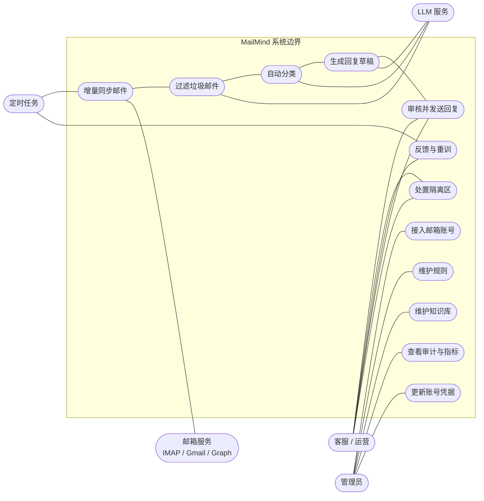

# 01 用例图

参与者与系统提供的用例。Mermaid 没有原生 UML 用例图，这里用带系统边界的流程图近似表达，
语义与 UML 用例图一致（参与者 — 用例 — 系统边界）。

**说明**

- `UC-02 → UC-03 → UC-04 → UC-05 → UC-06` 是主价值链，其余用例为其提供支撑；
- LLM 只在三处被调用：垃圾模糊区复核、分类低置信度兜底、回复起草；
- 用例规格见 [需求说明书](../需求说明书.md) 第 3 节。
