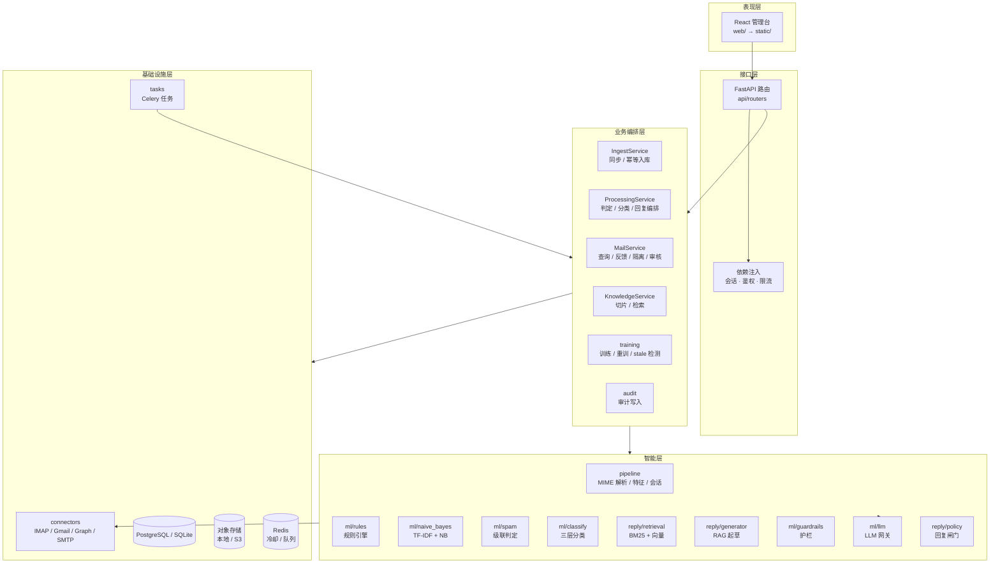

# 02 组件架构图

UML 组件图：按职责分层，箭头表示依赖方向（上层依赖下层，下层不反向依赖）。

**说明**

- 依赖单向：`api → services → ml/pipeline → connectors/storage`，便于替换 LLM、embedding、存储；
- `ProcessingService` 是编排中心：解析结果 → 特征 → 判定 → 分类 → 回复闸门 → 起草；
- 外部依赖都通过协议注入（`MailConnector`、`MessageSender`、`LLMGateway`、`Embedder`），测试可完全离线。
