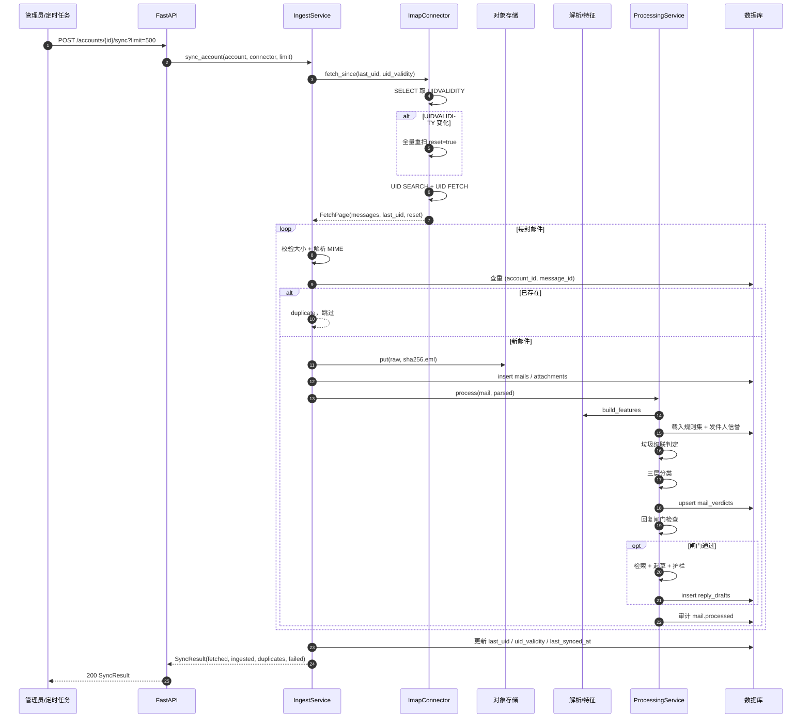

# 03 时序图：邮件接入与处理

从触发同步到判定、分类、草稿落库的完整调用链（正常路径）。

**关键点**

- `Message-ID` 是幂等键：重复同步/重复投递都只会得到 `duplicate`；
- `UIDVALIDITY` 变化必须全量重扫，否则会静默漏信；
- 单封失败只记 `failed` 并继续，不阻断整批；
- 游标只在整批处理完成后提交，保证"至少一次"而不是"丢一批"。
