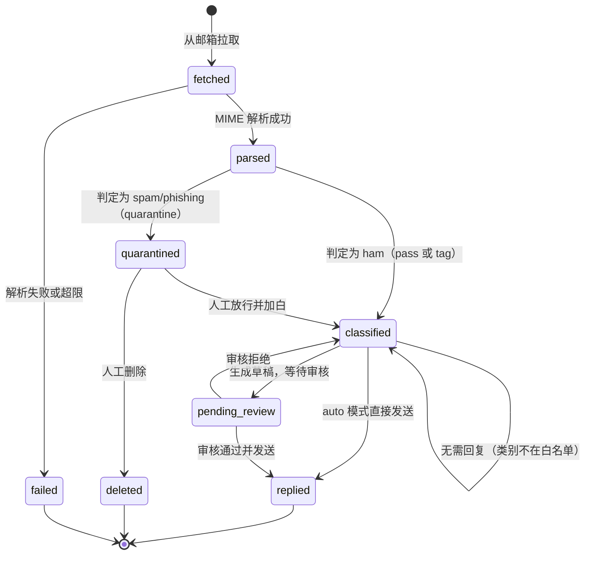

# 05 状态图：邮件生命周期

一封邮件在系统中的主状态机。

**状态含义**

| 状态 | 含义 | 可执行动作 |
|---|---|---|
| `fetched` | 已入库，未解析完成 | 重试解析 |
| `parsed` | 解析完成，待判定 | 重新判定 |
| `classified` | 非垃圾，已分类 | 起草、反馈、归档 |
| `quarantined` | 进了隔离区 | 放行（加白）、删除 |
| `pending_review` | 有草稿等待人工 | 通过、改稿、拒绝 |
| `replied` | 已发送回复 | 只读 |
| `failed` | 处理失败 | 重处理（`run_process_mail`） |
| `deleted` | 软删除 | 不出现在列表 |

**草稿状态机**（`reply_drafts.status`）：
`draft → pending_review → approved → sent`，失败进 `failed`，审核拒绝进 `rejected`。
只有 `pending_review / draft / approved` 允许发送，避免重复投递。
