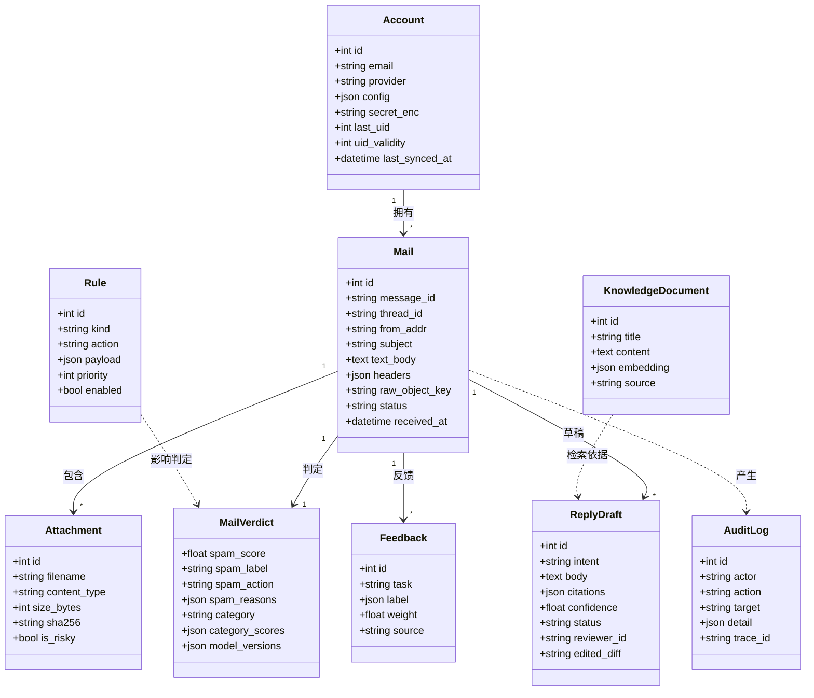

# 06 类图：领域模型

核心 9 张表及其关系（对应 `src/mailmind/db/models.py`）。

**设计说明**

- `MailVerdict` 与 `Mail` 一对一：判定结果可整体替换，便于模型升级后重算；
- `ReplyDraft` 与 `Mail` 一对多：同一封邮件可以多次起草（人工点"重新起草"）；
- `Rule` 与判定是"弱引用"：规则即时生效，不落外键，便于热更新；
- `Feedback` 带 `weight`（用户反馈 ×3），是重训样本的唯一来源；
- 原始邮件不进库，只存 `raw_object_key`（内容寻址）。
