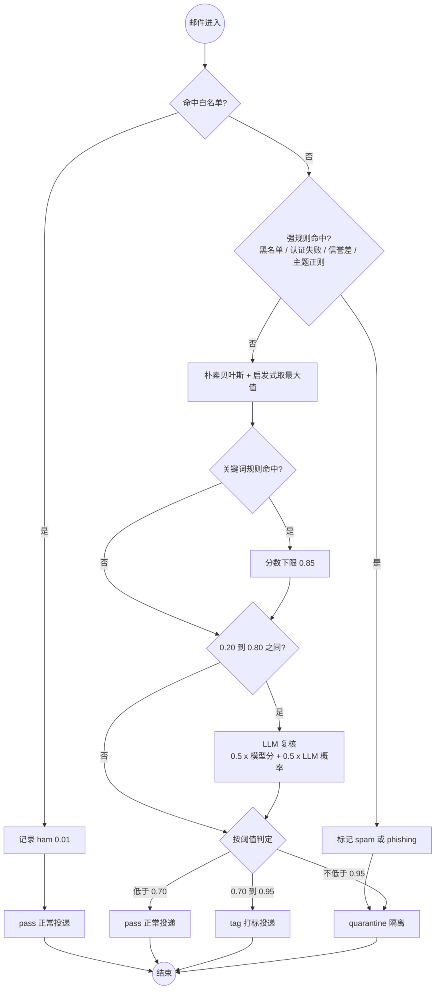

# 07 活动图：垃圾邮件过滤

级联判定过程与三档动作。

**要点**

- 白名单优先级最高：命中即放行，不受其他信号影响；
- 强规则（黑名单/认证失败/信誉/主题正则）直接隔离，不再打分；
- 只有 0.20–0.80 的"模糊区"才调用 LLM，控制成本与延迟；
- 三档动作而非二分类：`tag` 档让可疑邮件仍能送达但被标记，`quarantine` 可随时找回。

**对应代码**：`src/mailmind/ml/spam.py`、`ml/rules.py`、`pipeline/features.py`
**对应测试**：`tests/test_spam.py`、`tests/test_rules.py`、`tests/test_quality.py`
