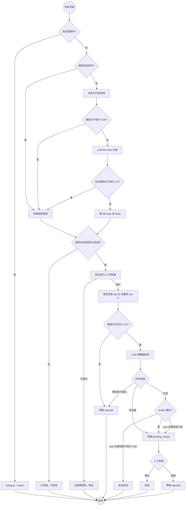

# 08 活动图：分类与回复决策

从判定完成到"发送 / 待审 / 拒绝"的完整决策过程。

**要点**

- 垃圾邮件短路：既不分类也不回复，避免"营销垃圾被分到咨询后自动回复"；
- 类别必须与白名单一致（有守护测试防止配置漂移）；
- 闸门不通过只记录原因码，不生成草稿；
- 无检索依据 → 拒绝，而不是让模型自由发挥；
- 默认 `review` 模式：所有草稿都要人工点通过。

**对应代码**：`ml/classify.py`、`reply/policy.py`、`reply/generator.py`、`ml/guardrails.py`
**对应测试**：`tests/test_classify.py`、`test_policy.py`、`test_generator.py`、`test_guardrails.py`
