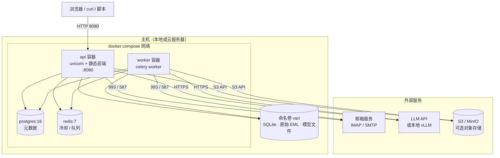

# 09 部署图

生产/演示环境的部署拓扑（docker compose 单机版，可平移到 K8s）。

**部署要点**

- 容器启动命令先执行 `alembic upgrade head` 再起服务，避免结构不一致；
- 前端在构建阶段（node 多阶段）产出静态文件，运行镜像只装 Python；
- `var/` 必须挂卷：SQLite、原始 EML、模型文件都在里面；
- 只暴露 8080；PostgreSQL/Redis 不对公网开放；
- 生产必须配置 `MAILMIND_API_KEY`、`MAILMIND_SECRET_KEY`，并通过反向代理启用 HTTPS。

**对应文件**：`Dockerfile`、`docker-compose.yml`、`alembic.ini`、`Makefile`
