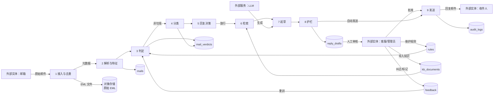

# 10 数据流图（DFD Level 1）

邮件数据在系统内的加工与存储。

**数据存储职责**

| 存储 | 内容 | 生命周期 |
|---|---|---|
| 对象存储 | 原始 .eml（sha256 寻址） | 可配置保留，支持重放 |
| `mails` / `attachments` | 结构化邮件与附件元数据 | 随保留策略 |
| `mail_verdicts` | 判定与分类结果（可重算覆盖） | 随邮件 |
| `rules` | 黑白名单/关键词/认证/分类路由 | 热更新 |
| `kb_documents` | 知识片段 + 向量 | 长期 |
| `reply_drafts` | 草稿、引用、置信度、审核痕迹 | 长期（审计） |
| `feedback` | 人工纠错样本 | 长期（训练数据） |
| `audit_logs` | 自动动作留痕 | ≥ 1 年 |
